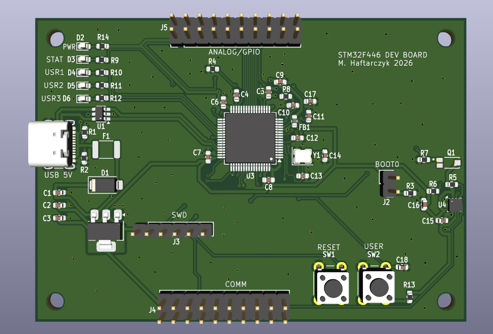
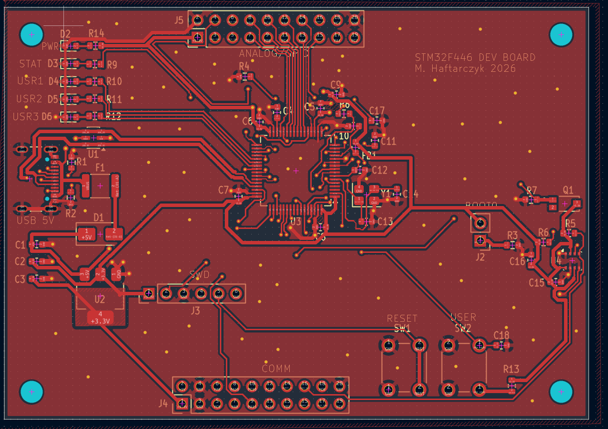
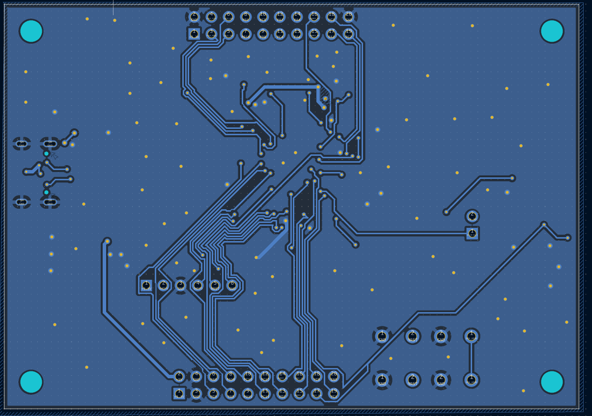

# STM32F446 Dev Board

PCB project for my PCB design course at university. The goal was to design a full board with a microcontroller, sensors, power supply and headers from scratch in KiCad, and to learn how to actually route a 2-layer board.

The board is based on the STM32F446RET6 (same MCU as on the Nucleo-F446RE I use) and is powered from USB-C.

## Pictures



Top layer:



Bottom layer:



## What's on the board

- STM32F446RET6 (LQFP64) with a 12 MHz crystal
- USB-C power input with ESD protection (USBLC6), PTC fuse and a reverse polarity diode
- 3.3 V LDO (LDL1117)
- BME280 - temperature, humidity and pressure sensor on I2C1
- TEMT6000 - ambient light sensor on the ADC (PA0)
- Power LED, status LED and 3 user LEDs
- RESET and USER buttons
- SWD header for programming (same pinout as CN4 on the Nucleo)
- BOOT0 jumper
- Two 2x10 headers for external stuff: COMM and ANALOG/GPIO

The board is 85 x 60 mm, 2 layers, with GND pours on both sides.

## What I used

- KiCad 10
- Freerouting
- STM32CubeMX (for checking the pin assignment)
- JLCPCB design rules
- Git

## Pinout

SWD (J3):

```
1  3V3
2  SWCLK (PA14)
3  GND
4  SWDIO (PA13)
5  NRST
6  SWO   (PB3)
```

COMM (J4):

```
 1  +3.3V              2  +5V
 3  GND                4  GND
 5  PC9                6  PA8
 7  PA9                8  PA10
 9  PA15              10  PC10
11  PC11              12  PC12
13  PD2               14  USART1_TX (PB6)
15  USART1_RX (PB7)   16  I2C1_SCL  (PB8)
17  I2C1_SDA  (PB9)   18  PC0
19  PC1               20  GND
```

ANALOG/GPIO (J5):

```
 1  +3.3V              2  GND
 3  SPI2_MOSI (PB15)   4  SPI2_MISO (PB14)
 5  SPI2_SCK  (PB13)   6  SPI2_NSS  (PB12)
 7  PB10               8  PB1
 9  PB0               10  PC5
11  PC4               12  PA7
13  PA6               14  PA4
15  USART2_RX (PA3)   16  USART2_TX (PA2)
17  PA1               18  PC3
19  PC2               20  GND
```

On-board stuff: BME280 on PB8/PB9, light sensor on PA0, status LED on PA5, user LEDs on PC6/PC7/PC8, user button on PC13.

USART1 is on PB6/PB7, not on the default PA9/PA10, so it has to be set that way in CubeMX.

## Project structure

```
plytkamh/
├── plytkamh.kicad_pro
├── plytkamh.kicad_sch
├── plytkamh.kicad_pcb
├── lib/        custom symbols/footprints (LDL1117, TEMT6000)
└── gerber/     files for the PCB manufacturer
```

## Notes

The first version of the board was 70 x 50 mm, but I couldn't fit all the header signals, so I made it bigger (85 x 60 mm).

At first the header pinout was done only in the schematic, without thinking about where the pins are on the MCU. During routing it turned out that half of the signals had to go around or under the whole chip. I changed the pinout so J4 gets the pins from the bottom side of the MCU and J5 from the top side, in the same order as on the package. After that the routing was much easier.

Power, USB, the crystal and all the decoupling capacitors were routed by hand. The rest of the GPIO lines going to the headers were routed with Freerouting and then cleaned up manually.

I also had a mistake in the schematic where the crystal wire was shorting PH1 with a few other pins. ERC didn't catch it because it was just one valid net, I found it when checking the netlist.

The BME280 is placed at the edge of the board, far from the LDO and the MCU, so it doesn't measure the heat from the board instead of the air.

## Status

Schematic and PCB are done, DRC is clean and the Gerber files are generated. The board hasn't been ordered or tested yet.
